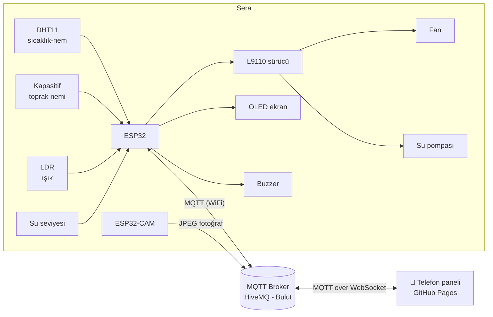

# 🌱 Akıllı Sera (IoT + MQTT + Bulut)

ESP32 tabanlı akıllı sera. Sıcaklığı, nemi, toprak nemini, ışığı ve su deposunu ölçer. Toprak kuruyunca **otomatik sular**, hava ısınınca **fanı açar**. Bütün verileri **MQTT ile buluta** gönderir. Telefondan **izleme, uzaktan kontrol ve kamera** desteği vardır.

- 🔬 **Wokwi simülasyonu:** https://wokwi.com/projects/481386561511788545
- 📱 **Kontrol paneli (telefondan açılır):** https://melikekrrgl.github.io/akilli_sera/
- 🎬 **YouTube videosu:** `VIDEO_LINKI`

---

## Sistem mimarisi



## Klasörler

| Klasör | İçerik |
|---|---|
| `firmware/sera_esp32/` | Ana ESP32 kodu + **Wokwi dosyaları** (`diagram.json`, `libraries.txt`) |
| `firmware/sera_cam/` | ESP32-CAM kodu (fotoğrafı MQTT ile gönderir) |
| `docs/` | Telefon kontrol paneli (`index.html`, GitHub Pages'te yayınlanır) |
| `tools/sahte_sera.py` | Donanım olmadan paneli denemek için sahte cihaz |

---

## 1) Wokwi'de çalıştırma

1. [wokwi.com/projects/new/esp32](https://wokwi.com/projects/new/esp32) adresini açın, giriş yapın.
2. `sketch.ino` sekmesine `firmware/sera_esp32/sera_esp32.ino` dosyasının içeriğini yapıştırın.
3. `diagram.json` sekmesine `firmware/sera_esp32/diagram.json` dosyasının içeriğini yapıştırın.
4. **Library Manager** sekmesinden `libraries.txt` dosyasındaki 6 kütüphaneyi ekleyin.
5. ▶ ile başlatın. Seri monitörde `MQTT'ye bağlanılıyor ... bağlandı` yazısını görmelisiniz.
6. **Save**'e basın, sonra **Share** ile linki alıp bu README'nin en üstüne yapıştırın.

Simülasyonda sensörleri elle değiştirerek sistemi deneyebilirsiniz:

| Simülasyondaki parça | Gerçekteki karşılığı |
|---|---|
| DHT22 (tıklayıp sıcaklığı ve nemi değiştirin) | DHT11 |
| Üstteki sürgü (GPIO34) | Kapasitif toprak nemi sensörü |
| Alttaki sürgü (GPIO32) | Su seviyesi sensörü |
| Foto direnç modülü | LDR modülü |
| Mavi LED (GPIO25) | Fan |
| Turkuaz LED (GPIO26) | Su pompası |

> Wokwi'de kamera parçası yoktur. Kamera yalnızca fiziksel prototipte çalışır.

## 2) Telefondan kontrol

Paneli telefonda açmanız yeterli, uygulama kurmaya gerek yok. Panel buluttaki MQTT broker'a bağlanır, yani **seradan uzakta, mobil veriyle de** çalışır.

- iPhone: Safari → Paylaş → **Ana Ekrana Ekle**
- Android: Chrome → ⋮ → **Ana ekrana ekle**

Panelde neler var:
- Canlı sensör kartları ve son 10 dakikanın grafiği
- **Otomatik / Elle** mod seçimi, pompa ve fan anahtarları, fan hızı
- Kameradan **fotoğraf çekme** (normal ve flaşlı)
- Eşik ayarları (fan sıcaklığı, sulama eşiği, sulama süresi…)
- Olay listesi (su bitti, sulama başladı…)
- "Bağlantı ayarları" bölümünden broker ve cihaz kimliği değiştirilebilir. Farklı bir kimlik linkle de verilebilir: `.../?id=sera-xxxx`

**GitHub Pages'i açma:** Repo → Settings → Pages → Source: *Deploy from a branch* → Branch: `main`, klasör: `/docs` → Save.

## 3) Bulut (MQTT)

| Konu (`akillisera/<DEVICE_ID>/…`) | Yön | İçerik |
|---|---|---|
| `telemetry` | ESP32 → bulut | 5 sn'de bir: `{"t":28.6,"h":62,"soil":56,"lux":350,"water":80,"pump":false,"fan":true,...}` |
| `status` | ESP32 → bulut | `online` / `offline` (retained, Last Will) |
| `config` | ESP32 → bulut | Güncel eşik ayarları (retained) |
| `event` | ESP32 → bulut | `{"level":"alarm","msg":"Su deposu boşalmak üzere!"}` |
| `cmd` | telefon → ESP32 | `{"pump":true}` `{"fan":false}` `{"mode":"auto"}` `{"fanSpeed":70}` `{"config":{"tMax":30}}` |
| `cam/image` | kamera → bulut | JPEG fotoğraf (retained) |
| `cam/cmd` | telefon → kamera | `capture` veya `flash` |

**Varsayılan broker:** `broker.hivemq.com` (ücretsiz, herkese açık). Kurulum gerektirmez, demo için idealdir. Herkese açık olduğu için cihaz kimliğini (`DEVICE_ID`) tahmin edilemeyecek bir şey yapın.

**Daha güvenli seçenek: HiveMQ Cloud (ücretsiz plan)**
1. [console.hivemq.cloud](https://console.hivemq.cloud) adresinden ücretsiz hesap açın ve bir *Serverless* cluster oluşturun.
2. *Access Management* bölümünden kullanıcı adı ve şifre oluşturun.
3. ESP32 tarafı: `secrets.h` dosyasındaki "Seçenek 2" satırlarını açın (port 8883, TLS).
4. Panel tarafı: Bağlantı ayarları → `wss://<cluster-adresi>:8884/mqtt`, kullanıcı adı ve şifre.

## 4) Fiziksel devre

### Bağlantılar (ESP32 DevKit)

| Parça | Parça ucu | ESP32 |
|---|---|---|
| DHT11 | VCC / DATA / GND | 3V3 / **GPIO15** / GND |
| Kapasitif toprak sensörü | VCC / AOUT / GND | 3V3 / **GPIO34** / GND |
| LDR modülü | VCC / AO / GND | 3V3 / **GPIO35** / GND |
| Su seviyesi sensörü | + / S / − | 3V3 / **GPIO32** / GND |
| OLED (I2C) | VCC / GND / SDA / SCL | 3V3 / GND / **GPIO21** / **GPIO22** |
| Buzzer | + / − | **GPIO27** / GND |
| L9110 sürücü | A-IA / A-IB | **GPIO25** / GND → Motor A çıkışı: **fan** |
| L9110 sürücü | B-IA / B-IB | **GPIO26** / GND → Motor B çıkışı: **pompa** |
| L9110 sürücü | VCC / GND | 5V adaptör (+) / ortak GND |

> ⚠️ Pompa ve fanı **ESP32'nin 3V3 pininden beslemeyin**. L9110'u 5V/2A adaptörden besleyin, adaptörün GND'sini ESP32'nin GND'siyle birleştirin. ESP32'nin analog okuması (GPIO32-35) WiFi açıkken sorunsuz çalışır. GPIO0, 2, 4, 12-15 ve 25-27 hattındaki ADC2 pinleri WiFi açıkken çalışmadığı için analog sensörlerde kullanılmamıştır.

### Yükleme

1. Arduino IDE → Kart yöneticisi → **esp32 by Espressif** (3.x) kurun.
2. Kütüphane yöneticisinden `libraries.txt` dosyasındaki kütüphaneleri kurun.
3. `firmware/sera_esp32/secrets.example.h` dosyasını aynı klasöre **`secrets.h`** adıyla kopyalayın, WiFi bilgilerinizi yazın, `DHT_TYPE DHT11` satırı açık kalsın.
4. Kart: *ESP32 Dev Module* → Yükle. Seri Monitör: 115200 baud.
5. **Kalibrasyon:** Seri Monitör'de görünen ham değerlere göre `secrets.h` dosyasında şunları güncelleyin: toprak sensörü kuru havada (`SOIL_RAW_DRY`), suyun içinde (`SOIL_RAW_WET`).

### ESP32-CAM

1. `firmware/sera_cam/secrets.example.h` → `secrets.h` (WiFi ve **aynı DEVICE_ID**).
2. Okuldaki **USB-TTL** ile bağlayın: TTL-5V → 5V, GND → GND, TX → U0R, RX → U0T, **IO0 → GND** (sadece yükleme sırasında).
3. Kart: *AI Thinker ESP32-CAM*, PSRAM *Enabled* → Yükle. Sonra IO0-GND bağlantısını çıkarıp RST'ye basın.
4. Kamera 60 saniyede bir ve paneldeki "Fotoğraf çek" düğmesine basıldığında fotoğraf gönderir.

> ESP32-CAM'i en az 5V/1A ile besleyin. Yetersiz güç, kartın kendini sürekli yeniden başlatmasının en sık sebebidir.

## 5) Otomatik kontrol mantığı

- **Sulama:** Toprak nemi `soilMin` (%40) altına düşerse pompa `pumpSec` (3 sn) çalışır. Ardından suyun toprağa işlemesi için `soakSec` (30 sn) beklenir ve ölçüm tekrarlanır. Bu sayede saksı taşmaz.
- **Havalandırma:** Sıcaklık > `tMax` (30 °C) **veya** nem > `hMax` (%80) ise fan açılır. Fan, sıcaklık 1 °C ve nem %3 düşünce kapanır (histerezis sayesinde sürekli aç-kapa yapmaz).
- **Güvenlik:** Depoda su %15'in altındaysa pompa hiç çalışmaz, alarm verilir. Elle açılan pompa da en fazla `pumpMaxSec` (15 sn) çalışır.
- Ayarlar panelden değiştirilebilir ve ESP32'nin hafızasına (NVS) kaydedilir, elektrik gidip gelse de korunur.

## 6) Donanım olmadan test

```bash
pip install paho-mqtt
python3 tools/sahte_sera.py --id sera-demo-4821
```
Sonra paneli açın. Sahte cihaz gerçek ESP32 gibi veri gönderir ve komutlara cevap verir.
